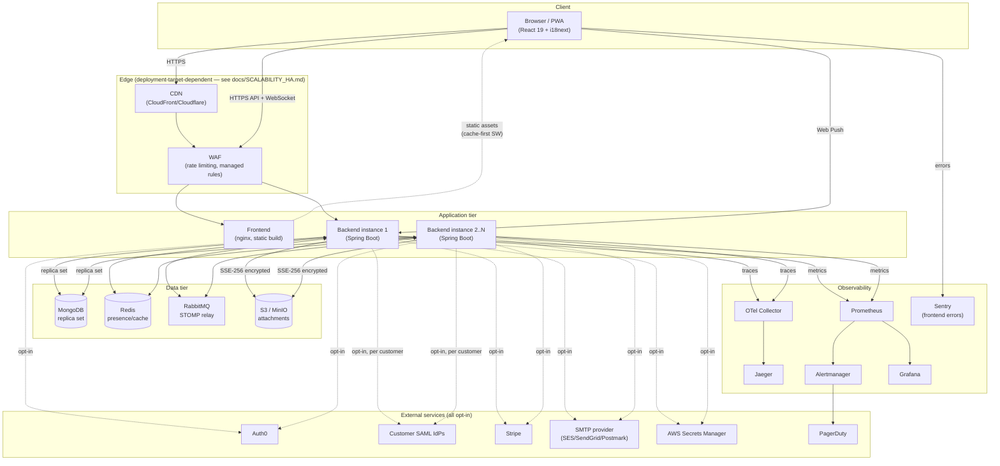
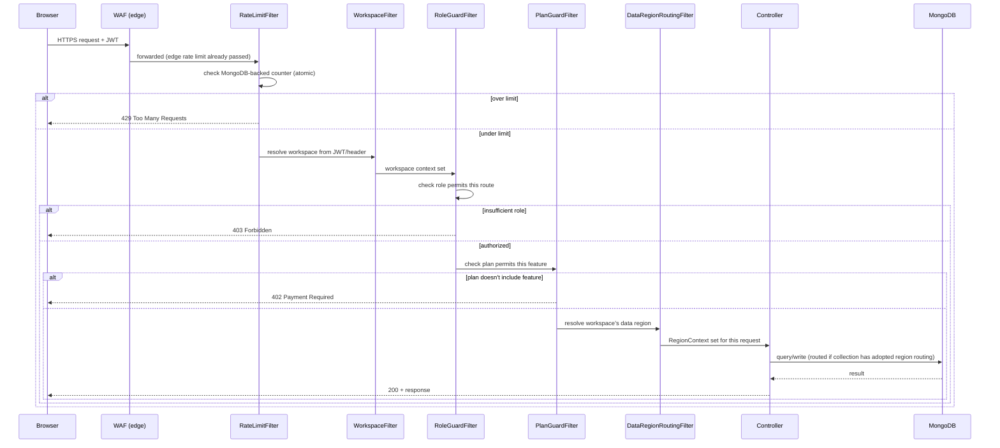
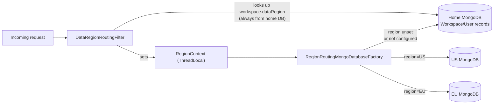

# Architecture

## System overview

## Request flow: authenticated API call

## Data residency routing (opt-in — see `docs/DATA_RESIDENCY.md`)

## Component inventory

| Layer | Technology | Notes |
|---|---|---|
| Frontend | React 19, Vite, i18next, Sentry | Served via nginx or a CDN |
| Backend | Spring Boot 4, Java 21 | 76+ controllers/services |
| Database | MongoDB (replica set) | Optional per-region routing |
| Cache/presence | Redis | WebSocket presence tracking |
| Message relay | RabbitMQ (STOMP) | Cross-instance WebSocket delivery |
| Object storage | S3-compatible | Optional — falls back to local disk |
| Tracing | OpenTelemetry → Jaeger | Or any OTLP-compatible vendor |
| Metrics/alerting | Prometheus + Alertmanager | Local stack or any Prometheus-compatible vendor |
| Dashboards | Grafana | |
| Error tracking | Sentry | Frontend only (opt-in) |
| CI/CD | GitHub Actions | Build, test, security scan, publish, deploy-ready images |

## Why these choices — see the ADRs

This document describes *what* the architecture is. For *why* specific choices were made (why
per-organization hash chaining instead of a global one, why OpenAPI-diff instead of full Pact, why
region routing is opt-in per-collection rather than a blanket change), see [`adr/`](./adr/) — each
significant decision made across this engagement has a corresponding ADR explaining the trade-offs
actually considered, not just the final answer.
