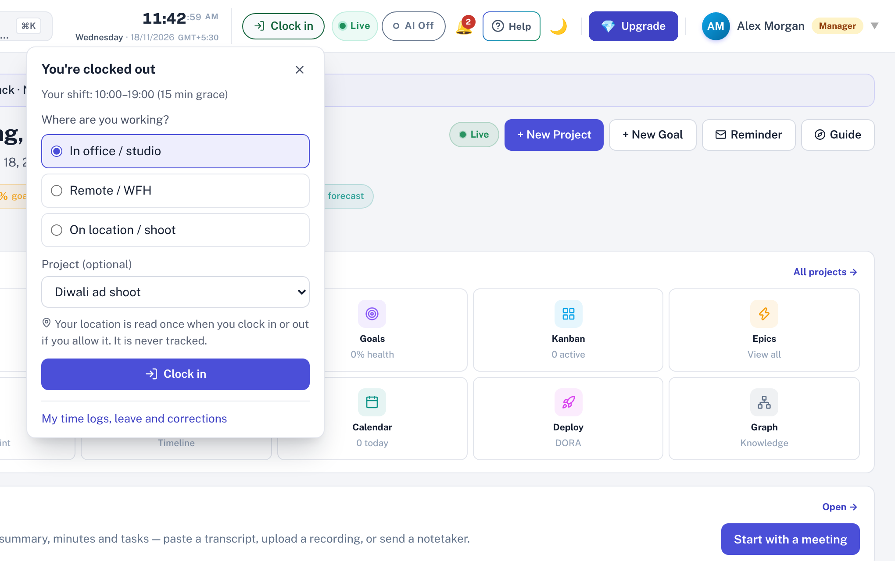
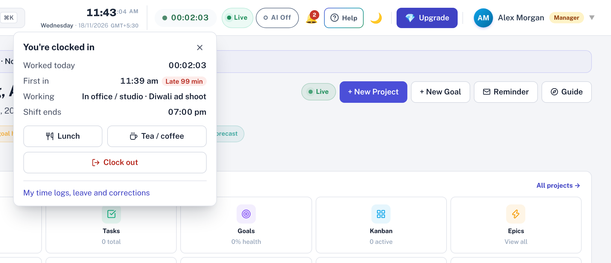
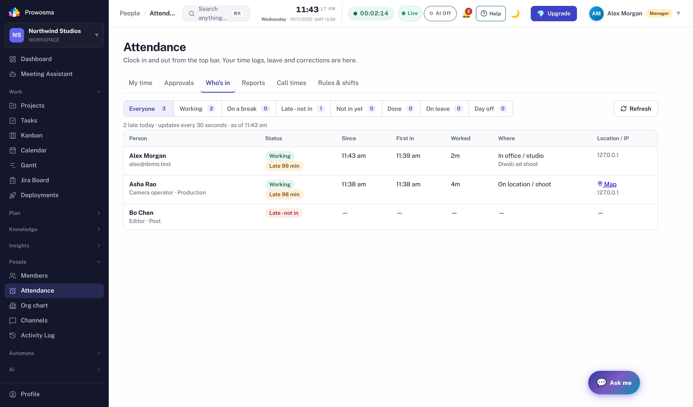

# Attendance (clock in / clock out)

Built natively in Prowosma from the client's attendance PRD. It is behind the **`attendance`** feature flag, which is **off by default**.
Turn it on in **Admin Centre → Feature flags → Attendance (clock-in)**. While it is off, nothing appears and every endpoint except
`/api/attendance/status` answers 404.

## For everyone: the quick version

1. **Clock in.** Click **Clock in** in the top bar, next to the clock. On a phone it's at the top right. Choose where you're working
   (**In office / studio**, **Remote / WFH** or **On location / shoot**). You can also pick a project. Then press **Clock in**.
2. **The button becomes a timer** (green) showing how long you've worked today.
3. **Breaks.** Click the timer, then **Lunch** or **Tea / coffee**. The button turns amber and counts the break. Press **End break** when you're back.
4. **Clock out.** Click the timer, then **Clock out**.
5. **Forgot to punch?** Go to **People → Attendance → My time** and click **Fix a missed punch**. Your manager or HR approves it.
6. **Leave.** Go to **Attendance → Request leave**. Weekends and holidays inside the dates aren't counted.
7. **Overtime.** Days with overtime show **Claim overtime**. After approval, overtime on a day off earns comp-off:
   a full day for 6 hours or more, or half a day for 3 hours or more.

### Questions people ask

**Am I late?** Your shift has a start time and a grace period, for example 10:00 with 15 minutes. Clocking in after 10:15 is late, counted from 10:00.
On a shoot day with a **call time**, the call time and its buffer replace your shift start.

**What if I step away?** If your admin turned on inactivity detection, Prowosma notices when there's no mouse or keyboard activity *in Prowosma* for a while:

- With **remind**, it asks "Still working?"
- With **pause**, it pauses the clock from when you went quiet. When you're back, it asks whether that time was work or a break.

Work done in other apps doesn't count as activity, so admins should pick the setting that fits the team.

**Is my location tracked?** No. If the workspace asks for it, your browser's location is read **once**, at the moment you clock in or out.
You can say no, unless your admin requires location for on-location work. The IP address of each punch is recorded.

**I forgot to clock out.** After the workspace's limit (16 hours by default), the session is closed automatically: at your shift end if
that falls inside the limit, otherwise at the limit. The day is marked **Clock-out missed**; use **Fix clock-out** to correct it.

## For admins and HR

Admins and HR use the Attendance page tabs:

| Tab | What it's for |
|---|---|
| **Who's in** | Live floor view: who's working, on a break, late and not in, not in yet, done, on leave or off. Shows work mode, project, a map link for the punch location, and the IP. Refreshes every 30 seconds. |
| **Approvals** | Missed-punch corrections, leave and overtime claims. Managers see their direct reports' requests (the *Manager* set on the person in Members / Org chart). Admins and HR see everyone's. Nobody approves their own. |
| **Reports** | One row per person per day: Present, Late, **No-show** (a past working day with no punch and no approved leave), Leave, Holiday, Weekend. **CSV** and **Excel** export for payroll (admins and HR only). |
| **Call times** | Per-project shoot or on-set call times, with buffer, location and crew. For the crew, they replace the shift start that day. |
| **Rules & shifts** | Shifts (e.g. 10:00–19:00 Mon–Sat, 15 min grace; one default shift; one shift per person). Time zone, location at punch, inactivity, end-of-day reminder, automatic clock-out, overtime threshold (9 h by default), day-off overtime and comp-off, leave per year, HR emails. |

- **HR**: people listed in *Rules → HR* get the same attendance rights as admins (approve, see everyone, change rules, export), without being workspace admins.
- **Holidays** come from *Workspace settings → Holidays*. Nobody is marked a no-show on a holiday or on approved leave.
- **Until you add a shift**, everyone uses 10:00–19:00 on the workspace's working days, with 15 minutes' grace.
- **The dashboard's "online" number** shows the people clocked in right now while Attendance is on.
- **Viewers** can clock themselves in and out (attendance is about their own time), but they can't change anything else.
- **Department-restricted profiles** can use Attendance for themselves.

## API (`/api/attendance`, header `X-Workspace-Id`)

| | |
|---|---|
| Everyone | `GET status`, `GET me`, `POST me/clock-in` {workMode, projectId, sprintId, note, lat, lng, accuracy}, `POST me/clock-out`, `POST me/break/start` {type: LUNCH/TEA/OTHER}, `POST me/break/end` {countAsWork}, `POST me/idle` {since}, `GET me/logs?from&to`, `GET me/requests`, `POST me/corrections` {date, clockIn, clockOut, reason}, `POST me/leave` {fromDate, toDate, leaveType, halfDay, reason}, `POST me/requests/{id}/cancel`, `POST me/logs/{id}/overtime`, `GET me/balances`, `GET me/call-times`, `GET calendar?from&to` (holidays and approved leave; never the reason) |
| Managers, admins, HR | `GET approvals`, `POST approvals/requests/{id}` {approve, note}, `POST approvals/overtime/{logId}` {approve, note}, `GET report?from&to&email` (managers: themselves and their reports) |
| Admins, HR | `GET floor`, `GET report/export?format=csv\|xlsx`, `GET/PUT settings`, `POST/PUT/DELETE shifts`, `GET/POST/DELETE call-times` |

Collections: `attendance_logs` (one per person per work date: sessions with IP and location, breaks, totals, late, overtime and its approval,
comp-off), `attendance_shifts`, `attendance_call_times`, `attendance_requests` (corrections and leave), `attendance_settings`.
Worked time = sessions minus breaks. Overtime = worked time beyond the threshold, or all worked time on a day off or holiday.

Code: `backend/src/main/java/com/prowosma/backend/attendance/`, `frontend/src/components/ClockWidget.jsx`, `frontend/src/pages/Attendance.jsx`.
Changes to shared code are kept small:

- the self-service path is allowed in `RoleGuardFilter` and `AccessGatePolicy`;
- the dashboard's `onlineCount` (this number was never filled in before);
- the flag row in Admin Centre;
- the menu item and the top-bar slot.

## Testing

| What | Result |
|---|---|
| Backend: `AttendanceApiTest` (17) and `AttendanceRulesTest` (6) | All pass, run through the real HTTP API with an embedded database. They cover the flag, clocking in and out, IP and rounded location, breaks, idle pause, viewers, member and HR rights, the floor view and dashboard count, call times, corrections with manager approval, automatic clock-out, leave and no-shows, quotas, comp-off, CSV/Excel export (including protection against spreadsheet formulas), isolation between workspaces, and validation. |
| Whole backend suite | 760 tests, 0 failures. |
| Frontend: `ClockWidget.test.jsx` (8), `Attendance.test.jsx` (8), `SidebarNav.attendance.test.jsx` (2), `navConfig.test.js` | All pass. The API is mocked here. |
| Whole frontend suite | 532 pass. 10 fail in `Login.twoFactor.test.jsx`; those 10 already failed before this work and are unrelated. |
| Real run in Chromium against the real backend | Passed. Covered: clock in with work mode and project, the timer, a tea break, end break, clock out and back in, the dashboard "online" count, approving a correction (the corrected day shows 09:45–19:10), the floor view with a map link, and the phone layout. |

### Manual checks before release (UAT)

1. Turn the flag on. The clock appears in the top bar and Attendance appears under People without a page reload. Turn the flag off and both disappear.
2. Add your real shift and holidays. Clock in after the grace period and confirm *Late* shows the right number of minutes.
3. On a phone, clock in **On location** with location required. Allow location and confirm the map link on *Who's in* is right. Deny location and confirm the clear message.
4. Set *When inactive → Pause*, leave the tab idle past the limit, then come back and answer the "Were you working?" question.
5. Forget to clock out. The next day the log shows *Clock-out missed*; fix it, and approve the fix as the manager.
6. Request leave, approve it, and check the report shows *Leave*, not *No-show*.
7. Work on a Sunday, claim overtime, approve it, and confirm comp-off appears in the balances.
8. Export Excel for a month and check it with payroll.

### Not built yet

- Approved leave is not drawn on the main **Calendar** page yet. It is available from `GET /api/attendance/calendar` and in the reports.
- Inactivity detection only sees activity inside Prowosma. It can't see other apps.
- There are no email or push notifications for approvals. Requests appear in the approver's **Approvals** tab.
- There is no geofence. Locations are recorded and shown on a map, but they aren't checked against an office or set address.
