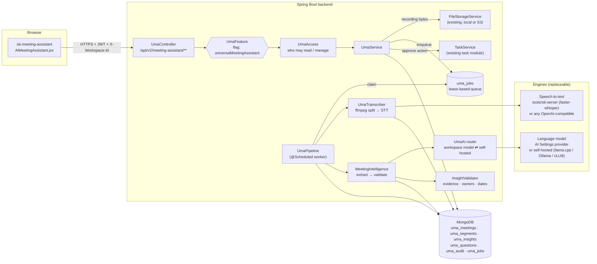
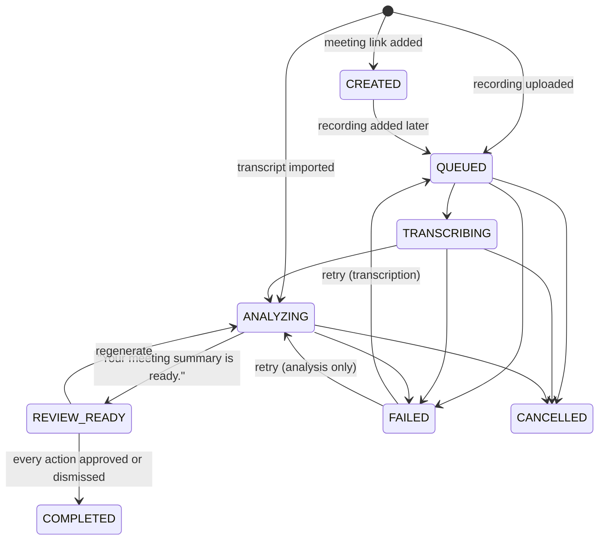

# Universal AI Meeting Assistant — Architecture

A new, separate module. The existing Meeting Assistant (`/api/meeting-assistant`, `/meeting-assistant`, its collections and jobs) is not changed, called or migrated.

## Diagram



## Processing states



Every transition is an atomic, guarded update (`UmaStore.transition`): it only applies if the meeting is still in a state that allows it, and it appends to the meeting's history. People see four labels: *Waiting for content*, *Processing*, *Ready for review*, *Needs attention* (plus *Completed* / *Cancelled*).

## Processing pipeline

1. **Upload** — the recording is the raw request body (not a multipart form), streamed to a temporary file with a hard size cap (default 500 MB), then stored through the existing `FileStorageService` (virus scan hook, local disk or S3). Consent must be confirmed.
2. **Queue** — a `TRANSCRIBE` job in `uma_jobs`. Workers claim jobs with a 10-minute lease (`findAndModify`), extend it between pieces, and retry temporary failures with back-off (30 s … 15 min, 5 attempts). A sweep re-queues meetings whose worker died.
3. **Transcribe** — `ffprobe` checks the file is audio; `ffmpeg` cuts it into 10-minute mono 16 kHz MP3 pieces; each piece goes to the speech-to-text engine. Progress is saved after every piece, so a restart resumes where it stopped. Silence/noise segments are skipped. Speakers are *not* separated (no diarization) — recordings show "Unknown speaker".
4. **Analyse** — the transcript is rendered as numbered lines (`[12] Speaker: text`) and sent with a strict JSON schema. Long meetings are split into ~40 000-character parts and merged; a reply cut off at the model's limit is redone on halves; unreadable JSON gets one repair attempt.
5. **Validate** (`InsightValidator`) — nothing reaches the user unchecked:
   - every item must cite existing line numbers **that actually talk about it** (shared words); a wrong line number is replaced by the one line that clearly matches, otherwise the item is dropped and counted;
   - an **owner** is kept only if that name is in a cited line (or, as a *suggestion only*, in the line right before/after); it is matched to a workspace member only on an unambiguous full-name match — first names alone are "suggested", never assigned;
   - a **deadline** is kept only if its words are in a cited line, and is resolved to a date relative to the meeting date;
   - IDs are stable hashes, so regenerating keeps people's edits, decisions and created-task links.
6. **Review** — `REVIEW_READY`: "Your meeting summary is ready. N action items to review."
7. **Approve** — creates a task through the existing `TaskService.create` (same permission checks as creating a task by hand). The task carries `sourceActionKey = "uma:{meetingId}:{actionId}"`; a unique index on it makes approval idempotent even under double clicks or races.

## Data model (new collections, all scoped by `organizationId`)

| Collection | One document per | Notes |
|---|---|---|
| `uma_meetings` | meeting | title, source, provider, link, time & timezone, project, creator, visibility (PRIVATE/WORKSPACE), sharedWith, status + history, error code & recovery hint, recording metadata, transcript metadata, consent record |
| `uma_segments` | transcript line | `seq` (1-based, stable — evidence points to it), start/end ms, speaker or null, text, edited flag. Unique (org, meetingId, seq) |
| `uma_insights` | meeting (id = meeting id) | summary, topic notes, decisions, action items, risks, questions, follow-ups — each with `evidence` line numbers; model, tokens, version, warnings |
| `uma_questions` | Ask AI question | question, answer, evidence, grounded flag, model |
| `uma_audit` | event | who did what and when — **no meeting content** |
| `uma_jobs` | job | type, status, lease, attempts, run-after; unique `jobKey` |

No existing collection is altered. Indexes are created at start-up (`UmaIndexConfig`); there are no data migrations.

## API (`/api/v2/meeting-assistant`)

| Method & path | Purpose |
|---|---|
| `GET /status` | Is the flag on, are speech-to-text and AI ready (never 404s; drives the menu item) |
| `GET /dashboard` | Upcoming, processing, ready for review, needs attention, recent, action items waiting |
| `GET /providers` | Each platform's capabilities with an honest state |
| `POST /detect-link` | Which platform a meeting link belongs to (https only) |
| `POST /meetings/recording?fileName=&consent=true&title=&meetingAt=&timezone=&projectId=` | Upload a recording (raw body) |
| `POST /meetings/transcript` | Import a transcript (JSON `{text,…}` or multipart file) |
| `POST /meetings/link` | Register a meeting link |
| `GET /meetings/{id}` | Meeting, transcript, insights, questions, permissions |
| `POST /meetings/{id}/recording` | Add the recording to a link-only meeting |
| `POST /meetings/{id}/retry` · `/regenerate` · `/cancel` · `/complete` | Lifecycle |
| `DELETE /meetings/{id}` | Delete meeting, transcript, insights, recording (created tasks stay) |
| `PUT /meetings/{id}/sharing` | PRIVATE / WORKSPACE, named people |
| `PATCH /meetings/{id}/segments/{seq}` | Correct a transcript line |
| `PATCH /meetings/{id}/actions/{actionId}` | Edit title, owner, due date, priority, project |
| `POST /meetings/{id}/actions/{actionId}/approve` · `/reject` · `POST /meetings/{id}/actions/approve` (bulk) | Decide action items |
| `POST /meetings/{id}/ask` | Grounded question about this meeting |
| `GET /meetings/{id}/export?format=md\|txt\|json\|docx` | Export (PDF is made in the browser) |
| `GET /meetings/{id}/audit` | History (creator/admin) |

Errors are `{code, message, recovery?}` with plain-language text.

## Module layout

```
backend/src/main/java/com/prowosma/backend/uma/
  model/     UmaMeeting, UmaSegment, UmaInsights, UmaQuestion, UmaAuditEvent, UmaJob, UmaStatus
  core/      UmaFeature, UmaAccess, UmaStore, UmaJobQueue, UmaIndexConfig, UmaTranscriber, AudioSplitter, OperatorHttp, UmaException
  ai/        MeetingAiModel, WorkspaceAiModel, SelfHostedAiModel, UmaAi, InsightPrompts, InsightValidator, MeetingIntelligence
  provider/  MeetingProviderAdapter, Providers (Meet, Teams, Zoom, Webex, Other), ProviderRegistry
  app/       UmaService, UmaPipeline, UmaRetention, UmaExporter
  web/       UmaController, StreamedUpload
frontend/src/  pages/AiMeetingAssistant.jsx · api/aiMeetingAssistant.js · hooks/useAiMeetingAssistantEnabled.js · styles/pages/ai-meeting-assistant.css
tools/stt-server/  self-hosted speech-to-text (faster-whisper, OpenAI-compatible API)
```

Reused from the existing code base without changing it: `TranscriptParser`, `TranscriptFileReader`, `TranscriptChunker`, `PromptBuilder.neutralize`, `DeadlineResolver`, `NameMatcher`, `ModelJson`, `OpenAiCompatibleSttClient`, `LlmClient`, `TaskService`, `FileStorageService`, `FieldEncryptionService`, `VisibilityService`.

## Provider adapters

`MeetingProviderAdapter` is the extension point for platform integrations (connect, discover meetings, fetch recording, fetch transcript, join). Today every platform adapter declares its capabilities honestly and the fetch/join methods answer *501 Not supported* with a recovery hint ("upload the recording or import the transcript instead"). Adding, say, Zoom cloud-recording import means implementing `fetchRecording` and flipping that capability's state once it has run against a real Zoom account.
