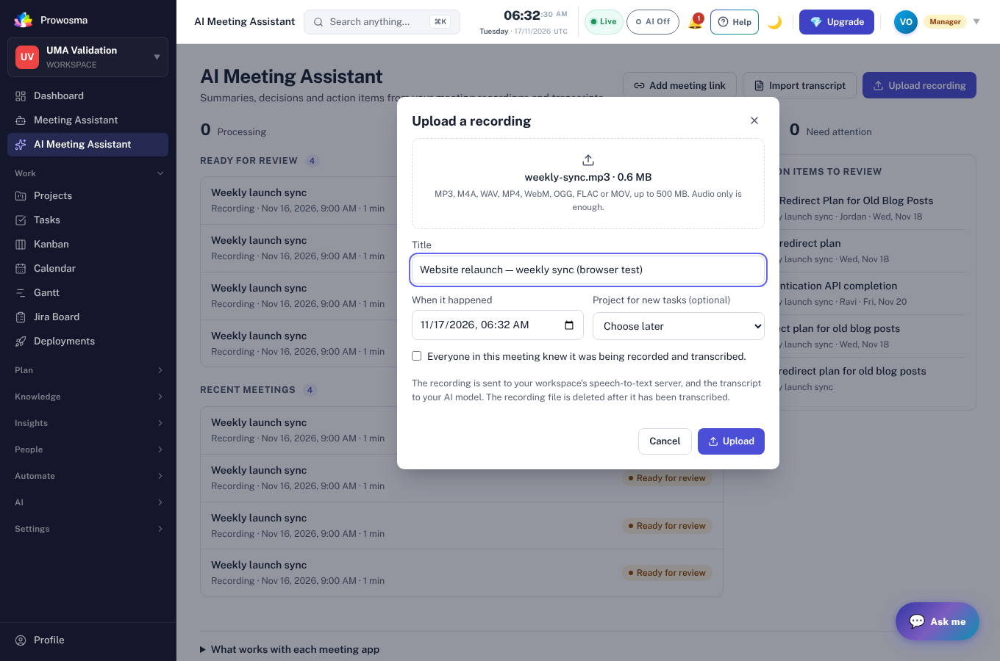
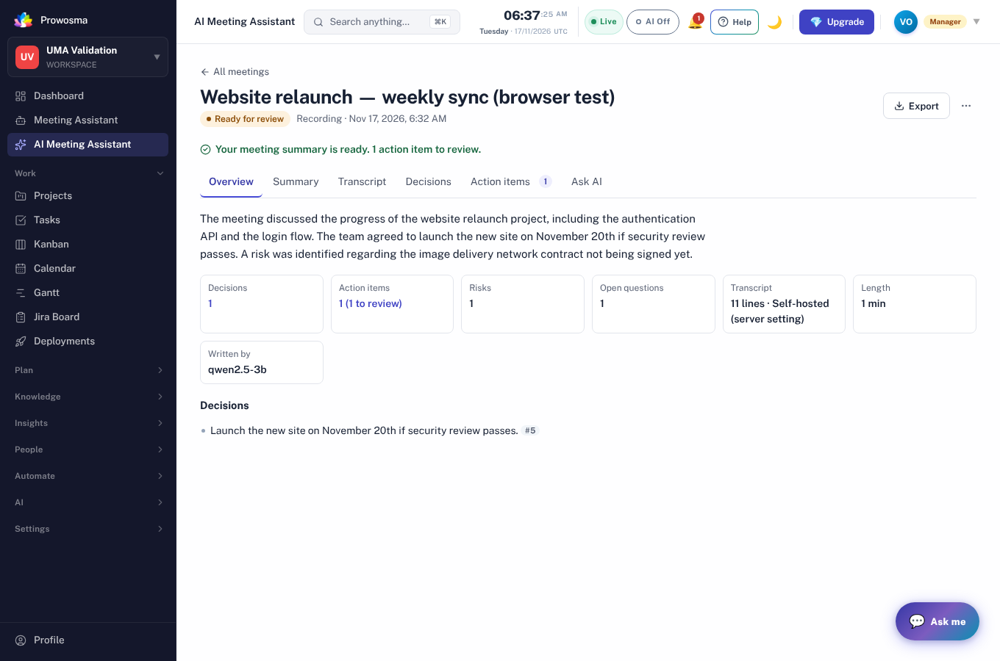
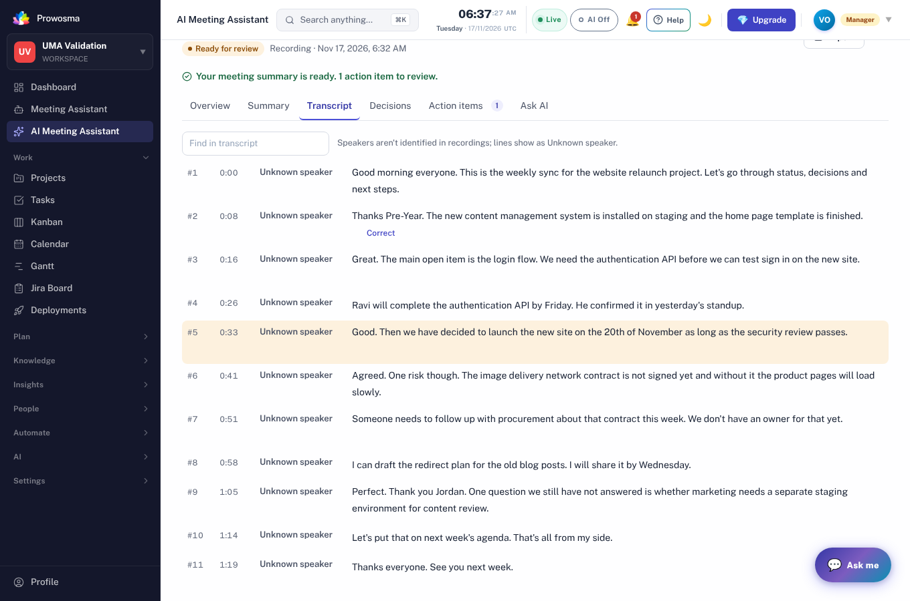
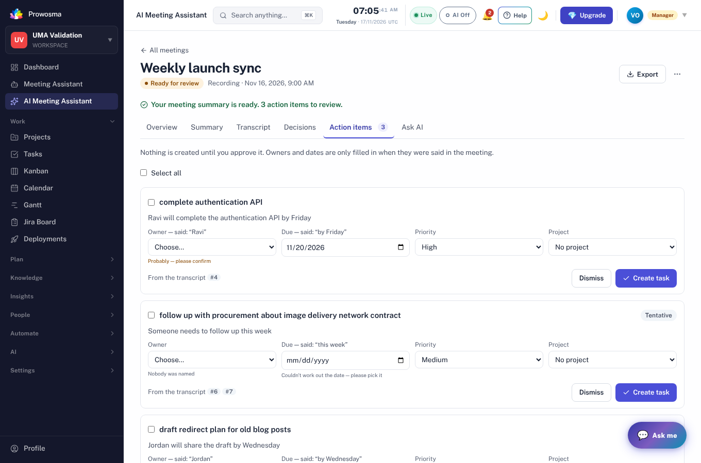
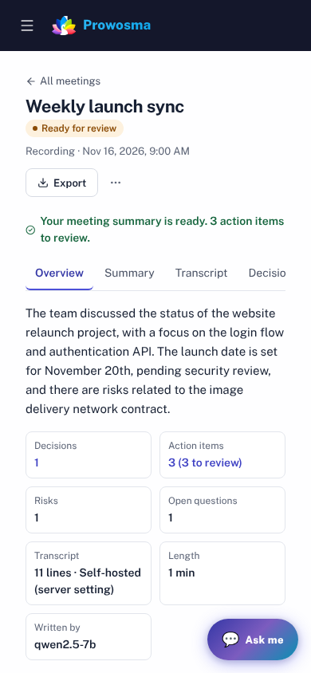

# AI Meeting Assistant — User guide

Turn a meeting into a summary, the decisions, and action items you can approve as tasks.

> The AI Meeting Assistant is separate from the existing **Meeting Assistant** page, which keeps working as before.
> It appears in the menu once an admin turns on **Admin Centre → Feature flags → AI Meeting Assistant (new)**.

## Three ways to add a meeting

| | Use it when | What happens |
|---|---|---|
| **Upload recording** | You have the audio or video file (MP3, M4A, WAV, MP4, WebM, OGG, FLAC, MOV — up to 500 MB) | It is transcribed, then summarised. About a minute for a short meeting. |
| **Import transcript** | Zoom, Teams, Google Meet, Webex or a notetaker already gave you a transcript (.vtt, .srt, .txt, .docx, or pasted text) | It is summarised straight away. Speaker names in the file are kept. |
| **Add meeting link** | Before the meeting, to keep it with its link | The assistant can't join meetings by itself. After the meeting, open it and add the recording. |

Before uploading you must confirm that **everyone in the meeting knew it was being recorded and transcribed**.

## Record a meeting live, or let a notetaker do it

- **Record meeting** — records the meeting tab (and your microphone) in Chrome or Edge while the meeting runs. Choose the meeting tab and switch on **Share tab audio** when the browser asks; press **Stop and summarise** at the end.
- **Send Fireflies notetaker** — on a meeting added by link, while it's running: Fireflies joins, and the transcript arrives by itself afterwards.
- **Google Meet** — once you've connected your Google account (**Connections**), the transcript of a Meet meeting you added is read automatically after the meeting (transcription must be on in the meeting).
- **Add → Import from Fireflies** — pick a recent Fireflies meeting.

Setup for each: [09-CONNECTIONS-SETUP](09-CONNECTIONS-SETUP.md).

## While it's processing

The meeting shows **Processing** with a progress bar. You can leave the page — it keeps going. When it's done you'll see **"Your meeting summary is ready."**

If something goes wrong the meeting shows **Needs attention** with what happened and what to do (for example "The speech-to-text key was rejected. An admin needs to fix it, then press Retry."). **Retry** picks up where it stopped — a meeting that was already transcribed is not transcribed again.

## Reviewing the results

- **Overview** — the summary and the counts.
- **Summary** — the summary and notes by topic.
- **Transcript** — every line, numbered. Find text, and **Correct** a line that was misheard (then use *Write the summary again* from the ⋯ menu).
- **Decisions** — decisions, risks and blockers, open questions, follow-ups.
- **Action items** — see below.
- **Ask AI** — ask a question about this meeting.

Every statement has small line references like **#5**. Click one to jump to that line of the transcript and check it yourself.

## Action items → tasks

Nothing becomes a task until you approve it.

- **Owner** — filled in only when the meeting named someone. If only a first name was said ("Ravi"), the assistant *suggests* the matching person and you confirm it. If nobody was named, it says so. It never guesses.
- **Due** — filled in only when a deadline was said ("by Friday" → the date). The words actually said are shown next to it.
- **Tentative** — the item was suggested rather than clearly agreed.
- Change the title, owner, date, priority or project, then **Create task**. Or tick several and create them together. **Dismiss** removes an item you don't want.
- A created task appears in **Tasks** like any other, with a note of which meeting and transcript lines it came from. Approving twice never creates two tasks.

When every item has been created or dismissed, the meeting is marked **Completed**.

## Ask AI

Answers come only from this meeting's transcript, with the lines they're based on. If the meeting doesn't answer the question, it says so ("This meeting's transcript doesn't clearly answer that.") instead of guessing. Check important answers against the referenced lines.

## Export

**Export** → Word, PDF, Markdown, plain text or JSON. Exports include the summary, decisions, action items (with owners and dates as said), risks, questions, notes and the numbered transcript.

## What works with each meeting app

The dashboard's **What works with each meeting app** section shows, for Google Meet, Teams, Zoom and Webex, what works today and what doesn't. Uploading a recording and importing a transcript work for all of them. Fetching recordings automatically and joining meetings live are not available yet.

## On a phone

The dashboard and meetings work on a phone; tabs scroll sideways.

## Who can see a meeting

A meeting is **private** to the person who added it and workspace admins. From the ⋯ menu choose **Share with the workspace** to let everyone in the workspace read it. Only the person who added it, or an admin, can change it, approve action items or delete it. Being in the meeting does not give access by itself.

**Delete meeting** removes the transcript, summary and recording. Tasks already created stay in Tasks.

## Good to know

- Recordings don't identify speakers; lines show as "Unknown speaker". Imported transcripts keep the names they contain.
- The recording file is deleted 24 hours after transcription (your admin can change this); the transcript stays until you delete the meeting.
- The AI can miss items or word them differently. Always review before creating tasks — that's why nothing is created automatically.
