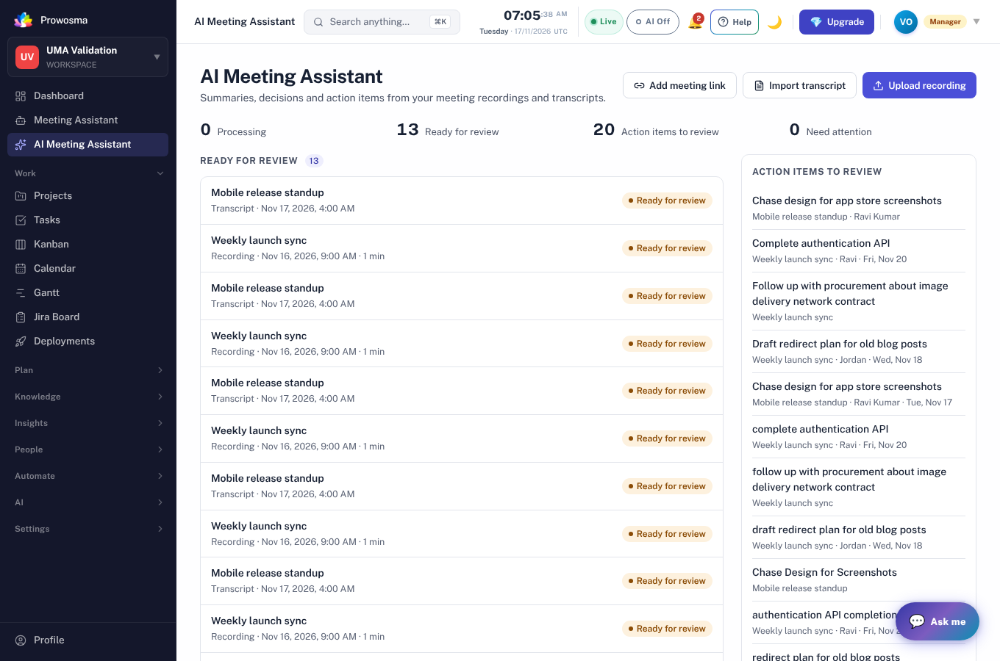
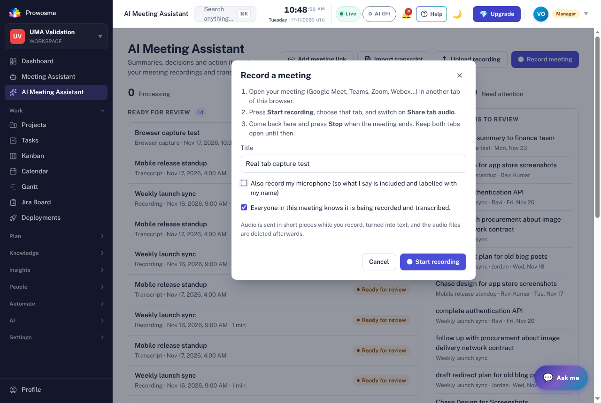
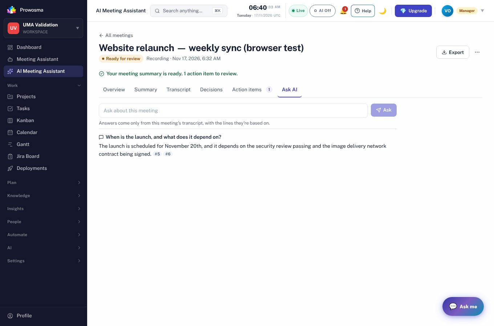
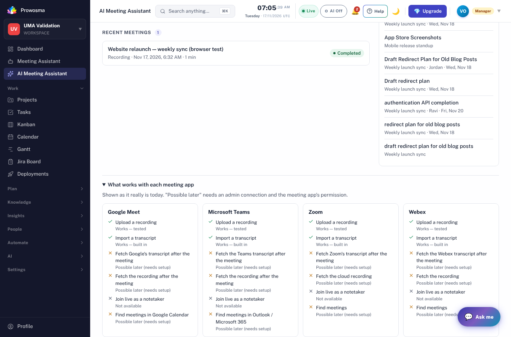

# AI Meeting Assistant — User guide

Turn a meeting into a summary, the decisions, and action items you can approve as tasks.

> The AI Meeting Assistant is separate from the existing **Meeting Assistant** page, which keeps working as before.
> It appears in the menu once an admin turns on **Admin Centre → Feature flags → AI Meeting Assistant (new)**.

## The quick version

1. **Start or plan the meeting.** Click **Meet now**, or **Add → Schedule a meeting**, and pick **Google Meet** or **Microsoft Teams**
   (your usual one is pre-selected - change it in **Settings**). Add the people who'll be there: they get the invitation.
2. **Join it from Prowosma** with **Join meeting**, and turn on the meeting's **transcription** (or let Fireflies join - click **Admit**).
3. **Talk as usual.** Say clearly who does what and by when: "Suresh, can you do the APIs by Thursday?" - "Yes, I'll do it."
4. **That's it.** A few minutes after the meeting you'll see **Meeting processed: 3 tasks created (3 assigned)…** The tasks are in
   **Tasks**, assigned to the people who were invited, in the project the meeting asked for.
5. **Check what waits for you.** Anything unclear waits on the meeting page with the reason - for example an owner who wasn't invited,
   something suggested rather than agreed, or a project only suggested. **Create task**, change it, or **Dismiss**.

What is created on its own:
- **Tasks** that were clearly agreed, with the cited transcript lines. Assigned only when the person was **invited to the meeting** (a first
  name counts only if just one invited person has it). In a meeting where you are the only person invited and the only one speaking
  (a solo **Meet now** test), what you take on is assigned to you. Deadlines are turned into dates only when clear: "Thursday" yes, "next Friday" no
  (the task is created without a date and you're told the likely one).
- **Projects** when someone clearly says one will be created ("Let's create a project called Customer Portal Development", "I'm going
  to create a project for this"). If no name is said, it gets a short name made only of words used in the meeting. "Maybe we should..."
  only suggests one - it waits for you. A project that already exists with that name is linked instead. "Create a project" / "create a
  task" are never tasks themselves: "a task that explains the feature" becomes the task "Explain the feature".
- Never: changes to existing tasks or projects, reassignments or deletions - whatever is said in the meeting.

No Fireflies? Click **Record meeting** before you start and share the meeting tab (Chrome or Edge).
Already have a recording or transcript? Use **Upload recording** or **Add → Import transcript**.

### What the meeting page tells you

| You see | What it means | What you do |
|---|---|---|
| **Scheduled** - "Starts 10:30" | Not started yet. Fireflies will join by itself at the start time. | Nothing. Click **Join meeting** when it's time. |
| **In progress** | Google Meet (or Fireflies) says the call is running. | Talk. In Meet, admit Fireflies if it's waiting. |
| **Getting transcript** - "Ended at 10:52" | The call has ended; the transcript is being prepared (2-10 min). | Nothing. You can leave the page. |
| **Meeting processed: …** | The notes are written and the clearly agreed tasks were created. | Check anything listed as *needs your review*. |
| **Completed** | Everything was created; nothing waits for you. | Nothing. |

### Questions people ask

**How does Prowosma know the meeting has ended?** For Google Meet it asks Google every minute who is still in the call. The meeting counts
as **over when the last real person has left** - notetaker bots (Fireflies and similar) don't count, even though Google keeps the call open
while they're connected. Prowosma waits 2 minutes after the last person leaves in case someone rejoins (if they do, it's *In progress* again).
You don't need *End call for everyone*: just leave.

**Fireflies is still in the call after everyone left - what happens?** The meeting is already shown as ended. Fireflies writes its transcript
once its notetaker leaves, which it normally does by itself a few minutes after everyone else. If it's still there after about 20 minutes,
the page tells you; the organiser can remove it in Meet (**People → Fireflies → Remove from call**) and the transcript follows.

**Why "Getting transcript" for a few minutes after the end?** Google and Fireflies need a few minutes to write the transcript. Prowosma picks
it up as soon as it exists. *Check now* asks again immediately.

**Do I have to send Fireflies?** No. It joins by itself as soon as the first person is in the meeting (Prowosma checks with Google every few seconds), so it never waits in an empty call and you don't wait for it. The only thing you may need to
do is click **Admit** in Google Meet. If it didn't arrive, the meeting page shows *Fireflies didn't arrive? Send it now* during the meeting.

**When do I use Record meeting?** Only when Fireflies isn't available: start it before the meeting, choose the meeting tab, tick
*Share tab audio*, and press *Stop and summarise* at the end.

**Why didn't a very short test meeting get a summary?** Meetings of a minute or less may not get a transcript from Fireflies. Talk for a few
minutes when you test.

## Three ways to add a meeting

| | Use it when | What happens |
|---|---|---|
| **Upload recording** | You have the audio or video file (MP3, M4A, WAV, MP4, WebM, OGG, FLAC, MOV — up to 500 MB) | It is transcribed, then summarised. About a minute for a short meeting. |
| **Import transcript** | Zoom, Teams, Google Meet, Webex or a notetaker already gave you a transcript (.vtt, .srt, .txt, .docx, or pasted text) | It is summarised straight away. Speaker names in the file are kept. |
| **Add meeting link** | Before the meeting, to keep it with its link | The assistant can't join meetings by itself. After the meeting, open it and add the recording. |

Before uploading you must confirm that **everyone in the meeting knew it was being recorded and transcribed**.

## Record a meeting live, or let a notetaker do it

- **Record meeting** — records the meeting tab (and your microphone) in Chrome or Edge while the meeting runs. Choose the meeting tab and switch on **Share tab audio** when the browser asks; press **Stop and summarise** at the end.
- **Send Fireflies notetaker** — on a meeting added by link, while it's running: Fireflies joins, and the transcript arrives by itself afterwards.
- **Google Meet** — once you've connected your Google account (**Connections**), the transcript of a Meet meeting you added is read automatically after the meeting (transcription must be on in the meeting).
- **Add → Import from Fireflies** — pick a recent Fireflies meeting.

Setup for each: [09-CONNECTIONS-SETUP](09-CONNECTIONS-SETUP.md).

## While it's processing

The meeting shows **Processing** with a progress bar. You can leave the page — it keeps going. When it's done you'll see **"Your meeting summary is ready."**

If something goes wrong the meeting shows **Needs attention** with what happened and what to do (for example "The speech-to-text key was rejected. An admin needs to fix it, then press Retry."). **Retry** picks up where it stopped — a meeting that was already transcribed is not transcribed again.

## Reviewing the results

- **Overview** — the summary and the counts.
- **Summary** — the summary and notes by topic.
- **Transcript** — every line, numbered. Find text, and **Correct** a line that was misheard (then use *Write the summary again* from the ⋯ menu).
- **Decisions** — decisions, risks and blockers, open questions, follow-ups.
- **Action items** — see below.
- **Ask AI** — ask a question about this meeting.

Every statement has small line references like **#5**. Click one to jump to that line of the transcript and check it yourself.

## Action items → tasks

Nothing becomes a task until you approve it.

- **Owner** — filled in only when the meeting named someone. If only a first name was said ("Ravi"), the assistant *suggests* the matching person and you confirm it. If nobody was named, it says so. It never guesses.
- **Due** — filled in only when a deadline was said ("by Friday" → the date). The words actually said are shown next to it.
- **Tentative** — the item was suggested rather than clearly agreed.
- Change the title, owner, date, priority or project, then **Create task**. Or tick several and create them together. **Dismiss** removes an item you don't want.
- A created task appears in **Tasks** like any other, with a note of which meeting and transcript lines it came from. Approving twice never creates two tasks.

When every item has been created or dismissed, the meeting is marked **Completed**.

## Ask AI

Answers come only from this meeting's transcript, with the lines they're based on. If the meeting doesn't answer the question, it says so ("This meeting's transcript doesn't clearly answer that.") instead of guessing. Check important answers against the referenced lines.

## Export

**Export** → Word, PDF, Markdown, plain text or JSON. Exports include the summary, decisions, action items (with owners and dates as said), risks, questions, notes and the numbered transcript.

## What works with each meeting app

The dashboard's **What works with each meeting app** section shows, for Google Meet, Teams, Zoom and Webex, what works today and what doesn't. Uploading a recording and importing a transcript work for all of them. Fetching recordings automatically and joining meetings live are not available yet.

## On a phone

The dashboard and meetings work on a phone; tabs scroll sideways.

## Who can see a meeting

A meeting is **private** to the person who added it and workspace admins. From the ⋯ menu choose **Share with the workspace** to let everyone in the workspace read it. Only the person who added it, or an admin, can change it, approve action items or delete it. Being in the meeting does not give access by itself.

**Delete meeting** removes the transcript, summary and recording. Tasks already created stay in Tasks.

## Keeping the list tidy

- **Automatically:** meetings are deleted **15 days after they took place** (transcript, notes and recording). An admin changes the number
  of days in **Settings → Delete meetings automatically after** - `0` keeps meetings until someone deletes them.
- **Several at once:** on the main page click **Select meetings**, tick them, then **Delete selected**.
- **Everything older than…:** **Clear old meetings** → choose *older than 15 days*, *a week*, *a day*, or *all that already happened*. It shows
  how many will go before anything is deleted.
- **One meeting:** open it → **⋯ → Delete meeting**.

You can delete only your own meetings (admins can delete any). Upcoming meetings, and meetings still being recorded or summarised, are
never cleared. **Tasks and projects created from a meeting always stay.** Deleting can't be undone.

## Good to know

- Recordings don't identify speakers; lines show as "Unknown speaker". Imported transcripts keep the names they contain.
- The recording file is deleted 24 hours after transcription (your admin can change this); the transcript stays until you delete the meeting.
- The AI can miss items or word them differently. Always review before creating tasks — that's why nothing is created automatically.
